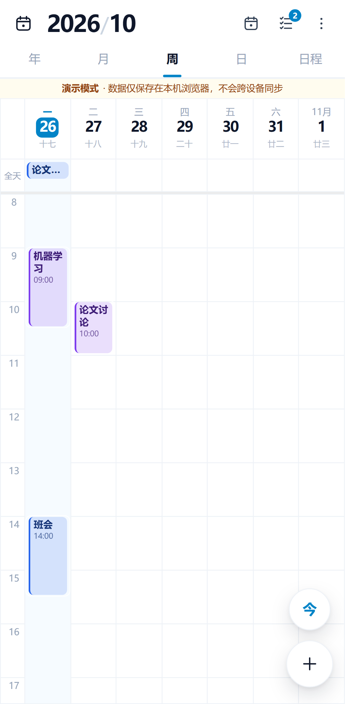
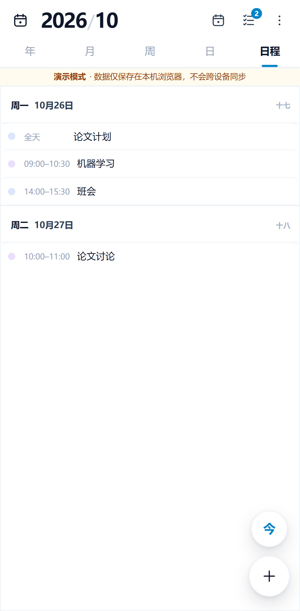
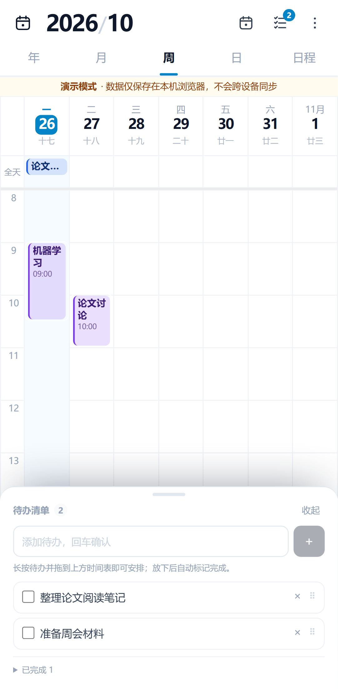
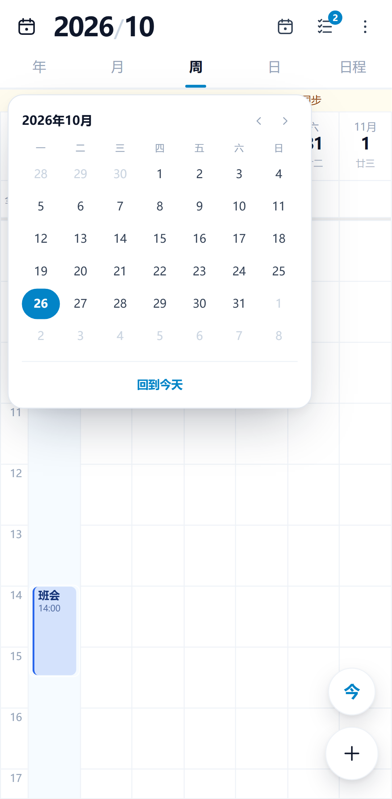
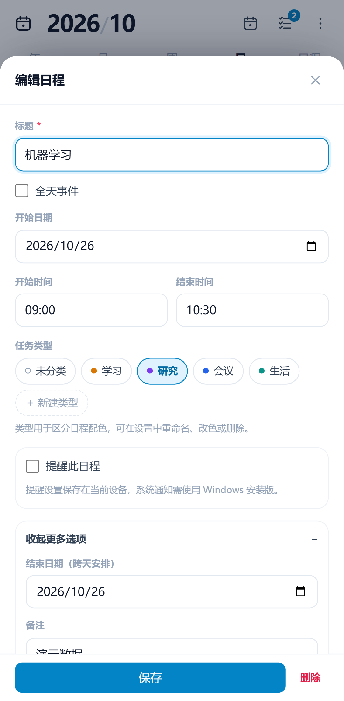
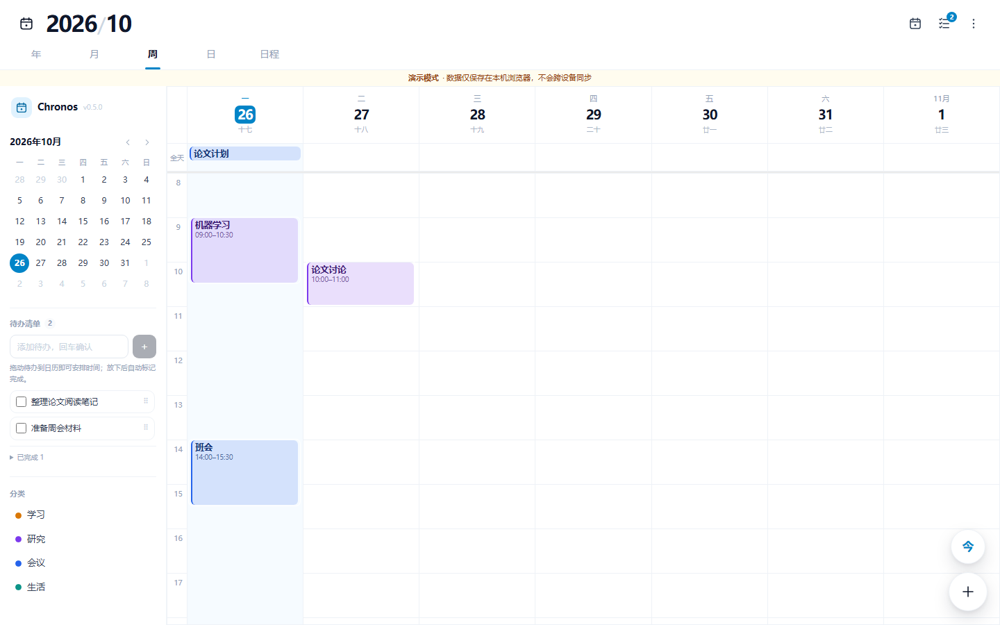
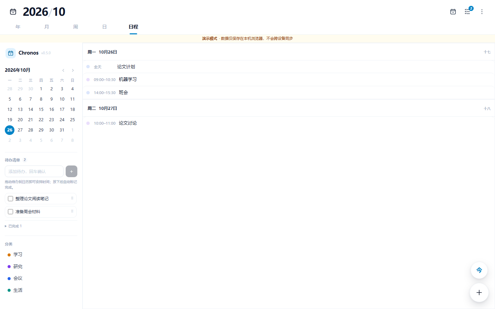

# Chronos Calendar

跨端同步日程表（个人日历 MVP）。React + TypeScript + Vite + FullCalendar v7 + Supabase（Auth / PostgreSQL / Realtime）+ PWA。手机与电脑使用同一套代码，通过同一账号同步日程，账户间严格隔离。

> **项目结构与功能说明**：[`docs/PROJECT_STRUCTURE.md`](docs/PROJECT_STRUCTURE.md)。其他文档见 [`docs/README.md`](docs/README.md)；初始设计见 [`docs/PROJECT_SPEC.md`](docs/PROJECT_SPEC.md)，原始开发提示已归档到 [`docs/archive/CODEX_CLI_PROMPT.md`](docs/archive/CODEX_CLI_PROMPT.md)。

## 界面预览

| 移动端 · 周视图 | 移动端 · 日程列表 |
| --- | --- |
|  |  |
| **移动端 · 待办清单** | **移动端 · 日期选择** |
|  |  |
| **移动端 · 编辑日程** | **桌面端 · 周视图（侧栏含待办）** |
|  |  |



截图来自演示模式（示例数据仅用于展示，不是产品默认类型）。

## 功能

- 邮箱魔法链接（Magic Link）与邮箱 + 密码两种登录、注册、会话保持、退出、设置密码。
- 中文年／月／周／日／日程视图，默认周视图；响应式年历包含十二个月；周一为一周开始；今天高亮、当前时间红线；**移动端左右滑动切换视图**，两端都不再使用左／右箭头按钮。
- 大标题「2026/10」+ 细下划视图标签 + 日期栏农历/节气小字；点击标题或日历图标打开日期选择；桌面侧栏/移动端浮层均可跳转日期；右下角悬浮「今 / ＋」。
- 日程新增、编辑、软删除；全天事件、跨天/跨午夜事件；分类配色（浅底 + 深字 + 左侧色条）；备注；时间重叠分栏显示。
- 周／日时间表支持 50%–200% 缩放：菜单按钮、Ctrl+滚轮、触屏双指缩放；保持正在查看的时间位置并记住比例。年／月视图保留缩放，分别调整月份排列和月历行高。
- 左侧时间列只显示小时数字（不再显示 `00:00` 分钟），列宽由约 44px 缩至约 28px，为日程卡片留出更多文字宽度；窄列日程显示开始时间，桌面完整显示时段。
- 时间表第一次点击选中点击位置所在的整点一小时（x:00–x+1:00），拖选先选中时段，再点击选中区域创建日程；选区带蓝色高亮、描边和「新建日程」按钮，拖动选区上下的粗线可按 15 分钟调整开始／结束时间。保存失败保留表单，点击编辑器外不关闭；关闭未保存表单时只能「放弃修改并关闭」或「继续编辑」；Ctrl+Enter 保存日程。
- **待办清单**：桌面端在左侧栏、移动端从顶栏清单图标打开底部抽屉（图标带未完成数量角标）；可新增、勾选、删除，直接拖到时间表生成 1 小时日程并自动完成；拖入月／年视图生成全天日程。真实账号同步到 Supabase `tasks` 表，演示模式保存在本机。
- **待办日程联动**：待办生成的日程带「待办」标记和 `task_id` 关联；第一次点击选中（可拖动／拉伸），再次点击进入编辑。编辑器可「移回待办清单」，桌面端也可把日程直接拖回左侧待办栏；移回时删除日程并恢复待办。连续拖动使用最新版本号，避免误报跨设备冲突。
- 系统提醒在单条日程中选择，默认关闭，可设开始时或提前 5／10／15／30 分钟；提醒设置按账号保存在当前设备，Windows 安装版负责通知。
- 删除、移动、调整时长与编辑后可撤销，支持 Ctrl+Z，保留本次页面会话最近 20 步；遇到其他设备更新时提示冲突。
- 细网格、蓝色日期强调与浅色日程块；周／日日期栏显示「星期 / 日期 / 农历或节气」，标题最多三行（短卡片自动收起时间行），悬停查看完整时间、备注和类型。
- 任务类型完全由用户创建，不再内置默认类型。新建日程时以彩色标签直接选择类型，也可在表单内新建类型；设置中可重命名、改色或删除，修改类型颜色会更新该类型的所有日程。
- **桌面端**：可收起的左侧栏（品牌、迷你月历、待办清单、分类筛选）；`← / →` 翻页、`T` 回到今天；拖拽移动、拉伸时长（失败自动 `revert()` 回滚）。
- **移动端**：以参考图为准的紧凑布局，大标题 + 三个图标操作 + 五段视图标签；左右滑动在年／月／周／日／日程之间切换；顶栏清单图标打开不遮满屏的待办抽屉，长按待办可拖入上方时间表；开始／结束时间使用数字输入，不弹出原生时钟表盘；PWA 可安装为独立 App，含 iOS 安全区适配与桌面图标。
- 编辑响应优化：打开编辑器不再触发 FullCalendar 重新排版；抽屉先完成首帧再聚焦标题并弹出输入法；类型标签与提醒区域独立渲染，键入标题时只更新必要部分。
- 基于可视区间查询（区间重叠，不漏跨界事件），不加载全量历史。
- 乐观并发控制：`version` 条件更新，冲突时提示并刷新，绝不静默覆盖。
- Realtime 订阅 + 浏览器焦点恢复 / 网络恢复兜底重取；登出清理订阅与缓存。
- 响应式、浅色/深色、中文、离线提示、PWA 安装与更新提示。

## 技术栈

| 层 | 技术 |
|---|---|
| 构建 | Vite + React 18 + TypeScript（strict） |
| 日历 | FullCalendar React **v7**（`@fullcalendar/react` 及其 `daygrid`/`timegrid`/`interaction` 入口） |
| 样式 | Tailwind CSS 3 + 少量组件 CSS |
| 日期 | date-fns + Intl（全天用 `DATE`，分时用 `timestamptz`） |
| 状态 | TanStack Query（远端缓存）+ React Context（Auth / 主题 / Toast） |
| 后端 | Supabase Auth + PostgREST + Realtime（无自建后端） |
| 测试 | Vitest + Testing Library + Playwright；RLS 用独立 SQL 检查 |

## 快速开始

```bash
npm install
npm run dev          # 开发服务器（无凭证时进入演示模式）
npm run dev:demo     # 强制演示模式（不读取 .env.local，适合验收界面）
npm run build        # 生产构建（含 PWA 生成）
npm run preview      # 预览生产构建
npm run lint         # ESLint
npm run typecheck    # TypeScript 严格类型检查
npm run test         # Vitest 单元测试
npm run test:e2e     # Playwright（需先 npx playwright install && npm run dev）
                     # 配置了凭证时可用 E2E_EMAIL / E2E_PASSWORD 跑真实登录用例
```

## 环境变量

复制 `.env.example` 为 `.env.local` 并填写：

```bash
VITE_SUPABASE_URL=            # 你的 Supabase Project URL
VITE_SUPABASE_PUBLISHABLE_KEY= # 你的 Supabase publishable（anon）key
VITE_DEMO_SEED=true            # 可选：演示模式是否预置示例数据
```

- 仅使用 **publishable key**，绝不把 `service_role` / secret key 放进前端。
- 两个变量都为空时，应用进入**显式标注的演示模式**（本地 `localStorage` 数据，不跨端同步、不伪称已同步）。

## 配置 Supabase（从零到可同步）

1. 在 [supabase.com](https://supabase.com) 新建项目。
2. 在 SQL Editor 中依次执行迁移：
   `supabase/migrations/202610080001_initial_schema.sql`、
   `supabase/migrations/202610190001_tasks.sql`、
   `supabase/migrations/202610200001_task_event_link.sql`
   （或使用 CLI：`supabase db push`）。它们会创建 `categories`、`events`、`tasks` 表、索引、触发器（自动维护 `version`/`updated_at`）、RLS 策略，并把表加入 `supabase_realtime` publication。
   - 0.3.x 数据库：补执行 `202610190001_tasks.sql` 和 `202610200001_task_event_link.sql`。
   - 已执行过待办迁移的 0.4.0 数据库：只需补执行 `202610200001_task_event_link.sql`（给 `events` 增加 `task_id` 关联）。
   未执行待办迁移时，日程仍可正常使用，但待办面板会提示「待办表尚未创建」；执行迁移后点面板中的「重试」即可，无需重新登录。
3. 复制 Project Settings → API 里的 **Project URL** 与 **anon publishable key** 到 `.env.local`。
4. 配置认证邮箱：Authentication → Providers → Email 启用。并在 Authentication → URL Configuration → Redirect URLs 加入本地地址（默认 `http://localhost:1420`）与正式域名。
5. 重启 `npm run dev`，使用邮箱 + 密码或邮箱链接登录，进入真实同步模式。

> 首次执行迁移前建议先在开发项目验证结构。迁移工具应管理执行版本，不要在远端反复手工执行同一迁移。

## 登录方式与邮件限额（重要）

应用提供两种登录方式，可在登录页顶部切换：

| 方式 | 说明 | 邮件配额 |
|---|---|---|
| **邮箱 + 密码**（推荐） | 注册 / 登录，多设备登录无需邮件 | 不消耗 |
| **邮箱链接** | Magic Link，点击邮件里的链接登录 | 每次消耗 1 封 |

⚠️ **Supabase 内置邮件服务限制为每小时 2 封**，且**只有配置自定义 SMTP 或 Send Email hook 才能调高**（见 [Rate limits 文档](https://supabase.com/docs/guides/auth/rate-limits)）。因此：

- 多设备测试、日常使用请用**邮箱 + 密码**，避免被限额卡住。
- 若已用魔法链接注册过账号：先登录一次，再到 **设置 → 账号 → 设置密码**，之后即可用密码登录。
- 若提示 `email rate limit exceeded`：等待约 1 小时，或改用密码登录，或在 Supabase 配置自定义 SMTP。

**仅测试想跳过邮箱确认**：Authentication → Providers → Email → 关闭 **Confirm email**，此时注册即登录、完全不发邮件（正式环境请重新打开）。

## 数据与安全要点

- **软删除**：删除是 `UPDATE events SET deleted_at = now()`，不是物理 `DELETE`；列表查询过滤 `deleted_at IS NULL`，Realtime 订阅不过滤它，以便收到删除通知。
- **待办**：`tasks` 表同样按 `auth.uid() = user_id` 隔离；待办可直接物理删除。由待办排入的日程在 `events.task_id` 记录关联，拖回待办时软删除日程并把待办恢复为未完成。
- **版本并发**：每次更新由触发器 `version = old.version + 1`；写入带 `id + user_id + version` 过滤，无返回行即冲突。
- **RLS**：`categories`/`events`/`tasks` 只允许 `auth.uid() = user_id` 的读写；`anon` 无权限；事件无物理 `DELETE` 授权；复合外键阻止事件或待办引用他人分类。
- **时区**：分时事件存 `timestamptz`，按浏览器本地时区显示；全天事件存 `DATE` 且 `end_date` 为 exclusive end。

## RLS 数据隔离测试

`supabase/tests/rls.test.sql` 用两个测试账号验证：未登录不可读、A/B 互相不可读改删、事件与待办不可引用他人分类。需要本地 Supabase 数据库：

```bash
supabase db reset
psql "<SUPABASE_DB_URL>" -v ON_ERROR_STOP=1 -f supabase/tests/rls.test.sql
```

> 需要真实数据库；SQL 采用 `set_config('request.jwt.claims', ...)` + `set role` 模拟两个登录身份。

## 部署

- Vercel / Cloudflare Pages：构建命令 `npm run build`，输出目录 `dist`，配置 SPA fallback（`/index.html`）与 HTTPS，注入两个环境变量。
- Supabase Auth 的 Redirect URLs 需加入正式域名。
- PWA：构建时生成 `sw.js` 与 `manifest.webmanifest`，图标为真实 PNG（`public/icons/icon-{192,512}.png`）。Workbox 只缓存静态资源，**不缓存** Supabase 认证与数据请求。

## 桌面版（Windows / Tauri 2）

桌面版复用同一套 React 前端，用 Tauri 2 打包为独立 Windows 程序。**登录与同步机制完全一致**（推荐「邮箱 + 密码」登录，无需回跳；「邮箱链接」会在系统浏览器打开，不回跳回桌面程序）。

前置依赖（已具备则跳过）：

- [Rust](https://rustup.rs)（MSVC 工具链）
- [Visual Studio C++ Build Tools](https://visualstudio.microsoft.com/visual-cpp-build-tools/)（“使用 C++ 的桌面开发”）
- Windows WebView2 Runtime（Win10/11 自带）

命令：

```bash
npm install
npm run desktop:dev      # 开发调试（会启动 Vite + 桌面窗口）
npm run desktop:build    # 生成安装包
```

产物：`src-tauri/target/release/chronos-calendar.exe`（独立可运行）与
`src-tauri/target/release/bundle/nsis/Chronos Calendar_0.5.0_x64-setup.exe`（安装包）。

桌面程序内嵌构建时的网页资源。修改源码或执行 `npm run build` 后，已经运行的 exe 不会自动更新；需要退出托盘中的旧程序，重新执行 `npm run desktop:build`，再启动新版 exe 或安装包。开发期间可用 `npm run desktop:dev` 查看实时更新。版本号显示在「更多操作」菜单底部与桌面侧栏，便于核对当前程序。

> 更新本地 exe 后如果界面仍显示旧版本，通常是托盘里还有旧进程：Tauri 单实例会唤起并聚焦已有窗口，而不会启动第二个程序。请从托盘菜单「退出」旧程序后再启动新 exe。

桌面增强（已实现）：

- **系统托盘**：托盘图标（左键唤起窗口，菜单含「显示主窗口 / 退出」）。
- **关闭到托盘**：点击窗口 X 隐藏到托盘（后台继续同步），退出走托盘菜单「退出」。
- **单实例**：重复启动时唤起已有窗口，避免多开。
- **自动更新（0.3.0 起）**：启动时检查本仓库的正式 GitHub Release；显示版本说明和下载进度，验证签名后安装并重启；支持手动检查、关闭启动检查和失败重试。首个正式 Release 与 Actions Secrets 配置见 [自动更新与发布说明](docs/AUTO_UPDATE.md)，推送源码不会直接更新已安装的软件。
- **开机启动**：设置中开启，登录 Windows 后自动启动到托盘；默认关闭。
- **日程提醒**：设置中开启，支持开始时或提前 5／10／15／30 分钟的系统通知，全天日程以 09:00 为基准；窗口隐藏后由原生线程继续检查提醒，发送成功后在本机去重。需要登录并联网加载近期计划；退出程序或关机后不再提醒。使用安装版验证 Windows 系统通知。

新版功能的操作与验收步骤见 [功能体验与测试指南](docs/FEATURE_TESTING.md)。

> ⚠️ **国内网络注意**：Tauri 打包时会从 GitHub 下载 NSIS/WiX 工具链，直连容易超时。设置镜像后重试即可：
>
> ```powershell
> $env:TAURI_BUNDLER_TOOLS_GITHUB_MIRROR = "https://ghfast.top"
> npm run desktop:build
> ```
>
> 桌面构建会通过 `TAURI_ENV_PLATFORM` 自动**禁用 PWA Service Worker**，Web 端不受影响。

## Android 版（Capacitor）

Android 版复用同一套 React 前端，用 Capacitor 打包为原生 APK。**登录与同步机制一致**（「邮箱 + 密码」直接可用；「邮箱链接」需后续接入 App Links 深链）。已适配返回键（关闭弹层优先）、软键盘 `adjustResize`、安全区、状态栏配色。

前置依赖：

- JDK 21+（本机使用 JDK 24，GitHub 发布使用 Temurin 21）
- Android SDK（`platform-tools`、`build-tools`、`platforms;android-36`）

命令：

```powershell
npm install
npm run build:cap            # 以 Capacitor 模式构建（禁用 PWA SW）
npm run mobile:sync          # 复制 web 资产并同步插件
.\android\gradlew.bat -p android assembleDebug    # 生成 debug APK（免配置发布签名）
.\android\gradlew.bat -p android assembleRelease  # 生成签名 release APK
npm run android:prepare     # 验证 APK 包名、版本和原签名，复制到 release/
```

产物：

- debug：`android/app/build/outputs/apk/debug/app-debug.apk`
- release（已签名）：`android/app/build/outputs/apk/release/app-release.apk`
- APK：`release/Chronos-Calendar_0.5.0_android.apk`；发布后可到 [Releases](https://github.com/dreamoon-2/chronos-calendar/releases) 下载。推送新版本 tag 时，Actions 同时构建 Windows 和 Android，两端检查通过后在同一 Release 上传安装包。Android 当前仍通过下载安装 APK 更新，未接入应用内自动安装。配置步骤见 [自动更新与双端发布](docs/AUTO_UPDATE.md)。

> ⚠️ **国内网络注意**：`dl.google.com` / `maven.google.com` 直连被墙，本仓库已做如下适配：
>
> 1. `android/build.gradle` 已把仓库指向**阿里云 Maven 镜像**；
> 2. `android/gradle/wrapper/gradle-wrapper.properties` 已把 Gradle 发行版指向**腾讯镜像**；
> 3. Android SDK 需手动从腾讯镜像安装（`dl.google.com` 不可达）：
>
>    ```powershell
>    # 已提供脚本 scripts/setup-android-sdk.ps1（下载 platform-36 / build-tools / platform-tools 并解压）
>    powershell -File scripts/setup-android-sdk.ps1
>    # 写入许可证（避免 AGP 因许可证未接受而失败）
>    # 已写入 %LOCALAPPDATA%\Android\Sdk\licenses\android-sdk-license
>    ```
>
> `local.properties` 已生成（指向 SDK）；换机器时设置 `sdk.dir` 和 `JAVA_HOME`。GitHub CI 使用官方 Maven 仓库、Gradle 下载地址和 SHA-256 校验；本机保留国内镜像。
>
> 发布签名已配置：`android/keystore.properties` + `android/chronos-release.keystore`（均已 gitignore）。请备份并沿用原密钥；新旧 APK 必须保持相同签名才能覆盖安装。`android/release-signing.json` 只保存公开证书指纹，发布时会核对该身份，避免误用其他签名。

## 手工验收（双设备闭环）

1. 电脑与手机分别打开并登录同一账号。
2. 电脑新建日程 → 手机无需刷新即出现；手机修改 → 电脑更新；删除 → 两端消失。
3. 断开网络：界面提示“离线，无法保存”，不出现假成功。
4. 恢复网络/切回前台：自动重新拉取并收敛。
5. 两个设备同时修改同一日程：后保存的一端提示“该日程已在其他设备更新，请重新加载”，不覆盖。
6. 另一账号（或退出登录后）看不到、也改不了这些数据。
7. 电脑或手机新增待办 → 另一端出现；把待办拖到时间表 → 生成 1 小时日程且待办进入已完成；把日程拖回待办栏或在编辑器点「移回待办清单」 → 待办恢复未完成。
8. 手机左右滑动切换年／月／周／日／日程，点击标题选择日期；桌面用 `← / →` 或侧栏迷你月历翻页。

## 已知限制

- 首版不做：重复日程（RRULE）、全局搜索、导出 ICS、离线可写、服务端提醒推送。
- 「日程」视图按周列出事件，不提供跨周搜索或独立的已完成状态。
- 待办目前固定按 1 小时排入日程，可在创建后编辑日程时长；待办标题创建后需删除重加。
- 草稿功能已移除：关闭有未保存内容的表单只能放弃修改或继续编辑，旧版本保存在本机的草稿不再读取。
- 移动端横向滑动用于切换视图；日历内部的横向拖选不再可用，点选与上下拖动选区粗线不受影响。
- 打开编辑器时先绘制抽屉再聚焦标题并弹出输入法；个别系统可能需要在标题上再点一次才弹出键盘。
- 触屏拖拽为渐进增强；移动端优先编辑表单。
- 未配置 Supabase 时只能验证界面与本地交互，无法验证真实跨端同步与 RLS。
